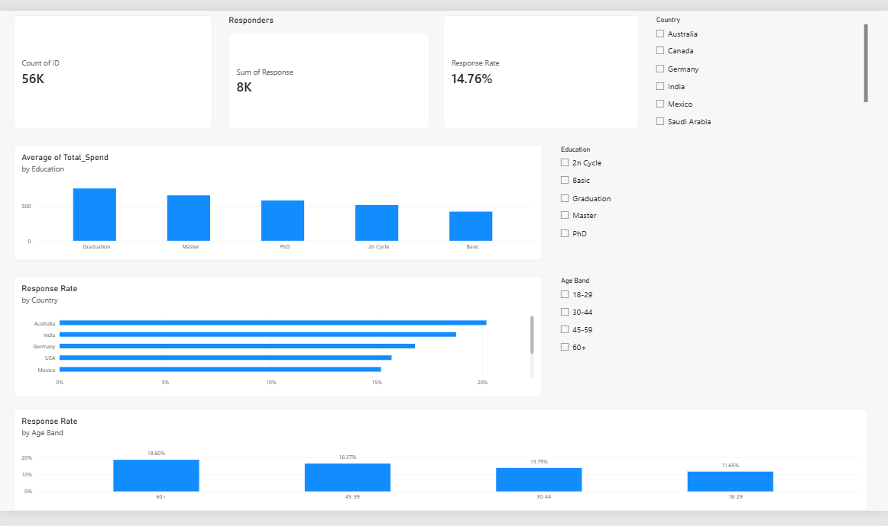

# Marketing Campaign Analysis

## Project Overview

This project analyzes customer data to understand marketing campaign responses, customer spending, and purchasing behavior.


## Dataset

The original dataset contains 56,000 customer records and 28 columns. The enriched dataset adds four fields: `Age`, `Total_Spend`, `Total_Purchases`, and `Children`.


## Tools Used

- Python
- SQL (SQLite)
- Power BI


## Project Files

- `marketing_campaign_data.csv` — original customer data
- `marketing_data_dictionary.csv` — column descriptions
- `marketing_campaign_enriched.csv` — data with added analysis fields
- `clean_data.py` — creates the enriched data file
- `load_database.py` — loads data into SQLite
- `marketing_campaign.db` — generated locally by `load_database.py`; not included in the repository
- `sql/analytics.sql` — analysis queries
- `Marketing_Campaign_Analysis.pbix` — Power BI dashboard


## Key Findings

- Overall campaign response rate was 14.76%.
- Australia had the highest country response rate at 20.19%.
- Customers aged 60+ had the highest age-group response rate at 18.60%.
- High spenders had a 26.04% response rate, compared with 13.51% for other customers.


## Dashboard

Open `Marketing_Campaign_Analysis.pbix` in Power BI Desktop. Use the Country, Education, and Age Band slicers to explore how customer groups compare.




## Recommendations

- Test tailored offers for high-spending customers, who showed a higher response rate.
- Explore campaigns for older customers, whose age group had the highest response rate.
- Test ways to re-engage customers with many web visits but low spending.
- Compare campaign results by country before choosing where to focus.


## How to Run

Run these commands from the project folder:

```powershell
python clean_data.py
python load_database.py

```

## Analysis Notes

- Age was estimated using `2014 - Year_Birth`.
- High spenders were defined as customers at or above the 90th-percentile spending threshold.
- Response rate is the number of customers with `Response = 1` divided by the total number of customers.

